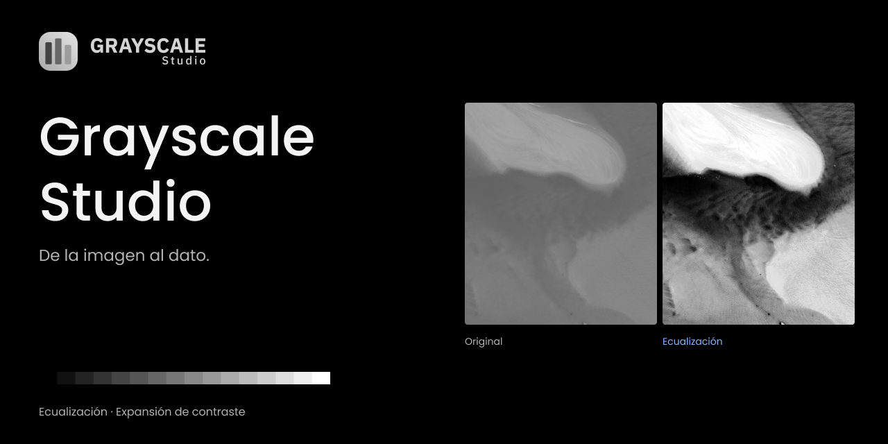
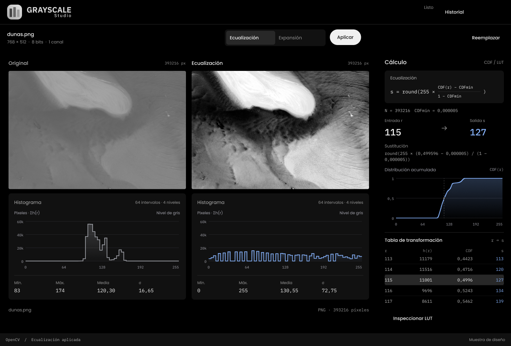
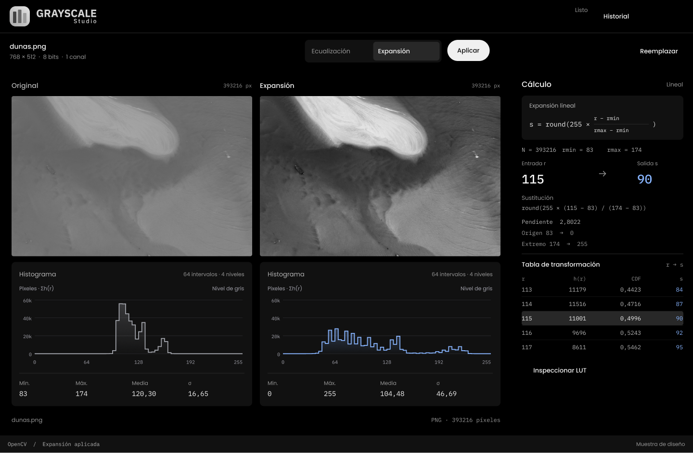
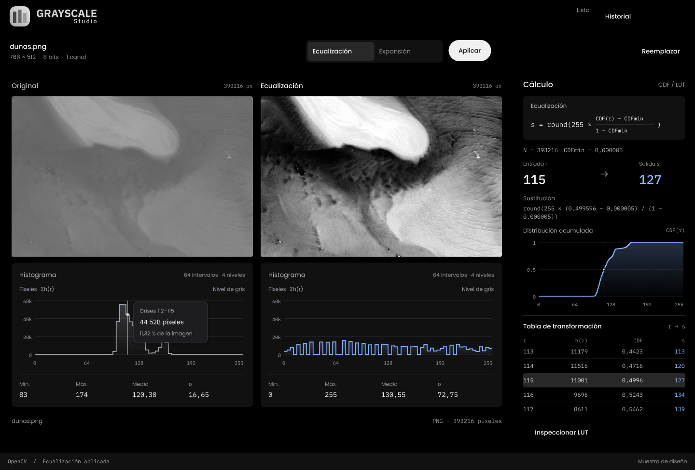
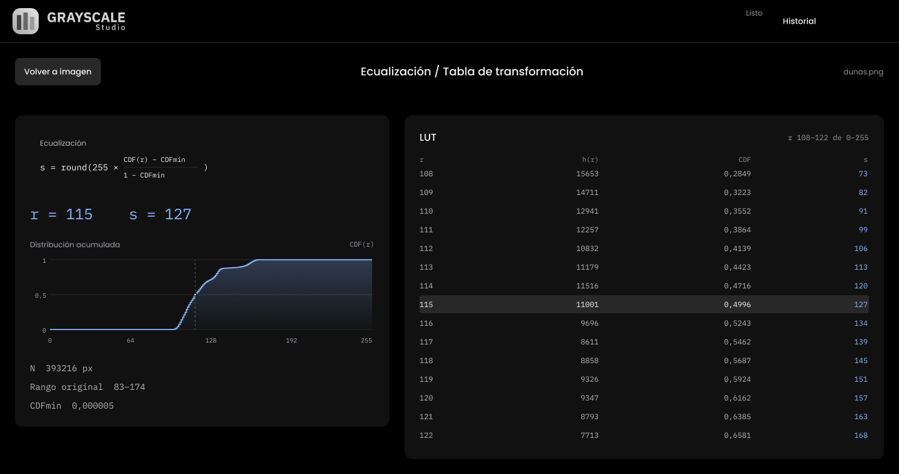
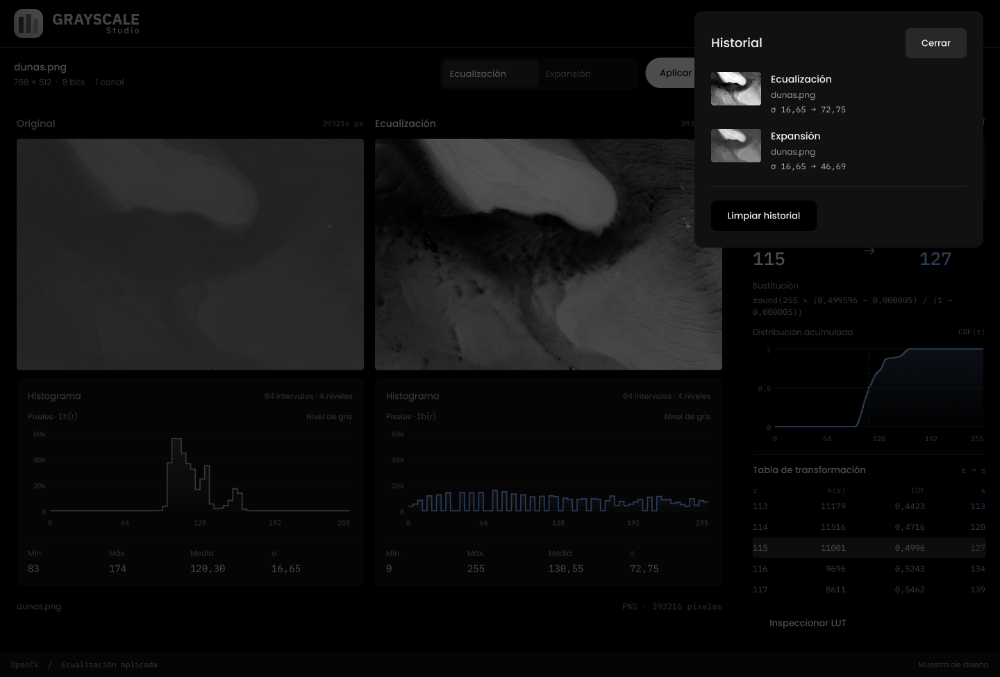
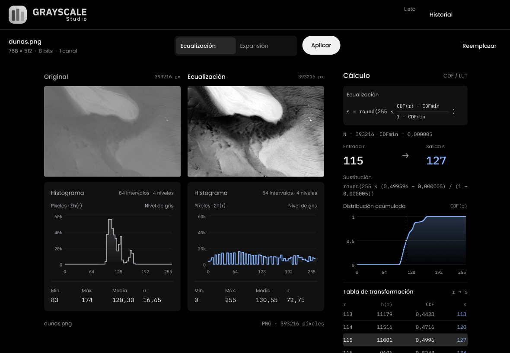
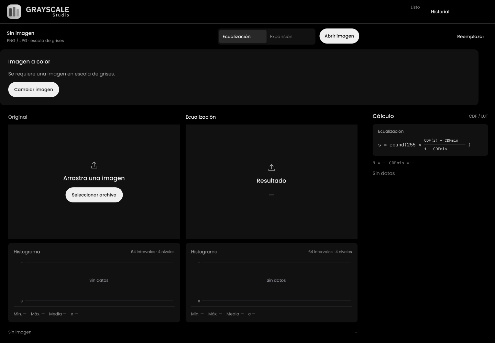

<!-- markdownlint-disable MD033 MD041 -->
<div align="center">
    <a href="https://grayscale.jahattrinidad.com/">
        
    </a>
    <p>
        <a href="https://grayscale.jahattrinidad.com/"></a>
        <a href="https://github.com/trinity-bytes/grayscale-studio/releases/tag/v0.10.0"></a>
        
    </p>
</div>
<!-- markdownlint-enable MD033 -->

**Grayscale Studio** es un estudio web para analizar y transformar imágenes en escala de grises. Carga una imagen, observa su histograma y aplica **ecualización** o **expansión de contraste**. Cada paso del cálculo queda visible: CDF, LUT y tabla de transformación.

Funciona en el navegador con **OpenCV.js** (WebAssembly) y **Chart.js**, sin backend. Está construido en Vanilla JavaScript con Web Components bajo **Clean Architecture** y **DDD**.

---

## Tabla de contenidos

- [Vista general](#vista-general)
- [Cómo funciona](#cómo-funciona)
- [Características](#características)
- [Inicio rápido](#inicio-rápido)
- [Uso](#uso)
- [Arquitectura](#arquitectura)
- [Testing y verificación](#testing-y-verificación)
- [Documentación](#documentación)
- [Licencia](#licencia)

---

## Vista general

<!-- markdownlint-disable MD033 -->
<p align="center">
    
    <br>
    <sub><b>Ecualización.</b> Original y resultado con sus histogramas. El inspector muestra la fórmula, la CDF y la tabla r → s.</sub>
</p>

<table>
    <tr>
        <td width="50%">
            
            <p align="center"><sub><b>Expansión Min-Max.</b> Estiramiento lineal del rango dinámico.</sub></p>
        </td>
        <td width="50%">
            
            <p align="center"><sub><b>Inspección del gráfico.</b> Selecciona una intensidad y sigue su transformación.</sub></p>
        </td>
    </tr>
    <tr>
        <td width="50%">
            
            <p align="center"><sub><b>CDF y LUT.</b> Los 256 niveles de la tabla de conversión.</sub></p>
        </td>
        <td width="50%">
            
            <p align="center"><sub><b>Historial.</b> Las últimas 20 operaciones, guardadas en el navegador.</sub></p>
        </td>
    </tr>
    <tr>
        <td width="50%">
            
            <p align="center"><sub><b>Tablet horizontal.</b> Layout compacto para 1024 y 1180 px.</sub></p>
        </td>
        <td width="50%">
            
            <p align="center"><sub><b>Validación estricta.</b> Las imágenes con color se rechazan.</sub></p>
        </td>
    </tr>
</table>
<!-- markdownlint-enable MD033 -->

> Las capturas provienen del diseño en Figma, con datos de muestra calculados a partir de píxeles reales.

---

## Cómo funciona

1. **Validación.** OpenCV.js comprueba que la imagen (PNG, JPG o JPEG) no tenga canales de color.
2. **Histograma.** Se extraen las frecuencias de las intensidades 0–255 y se renderiza el histograma original.
3. **Transformación.** Se aplica una de dos operaciones:

| Operación | Tipo | Fórmula |
|---|---|---|
| **Ecualización** | No lineal | `s = round(255 × (CDF(r) − CDFmin) / (1 − CDFmin))` |
| **Expansión** | Lineal | `s = round(255 × (r − min) / (max − min))` |

En la ecualización, `CDFmin` es el primer valor acumulado no nulo. El resultado se muestra junto a la imagen original con su propio histograma y sus métricas (mínimo, máximo, media y σ).

---

## Características

**Procesamiento**

- Carga por drag & drop o selección manual de archivos.
- Validación estricta de color: una imagen con color no registra operaciones.
- Ecualización por CDF con la sustitución numérica de cada nivel.
- Expansión Min-Max con el procedimiento explicado.

**Inspector matemático**

- Panel de cálculo persistente con fórmula, CDF y tabla de transformación.
- Selección de intensidad con teclado y LUT completa de 256 niveles.
- Tablas de frecuencias por histograma y métricas comparativas.

**Interfaz**

- Estudio oscuro con superficies neutras, Poppins e IBM Plex Mono servidas localmente.
- Operación explícita: elige Ecualización o Expansión y pulsa **Aplicar**.
- Historial lateral con las últimas 20 operaciones en `localStorage`.
- Indicador de estado del motor WASM, con estados de carga, error y reintento.
- Soporte para escritorio y tablet horizontal. En tablet vertical se pide girar el dispositivo, el teléfono no es compatible y en escritorio estrecho se pide maximizar la ventana.

---

## Inicio rápido

Requisitos: [Node.js](https://nodejs.org/) `^20.19.0` o `>=22.12.0` (exigido por Vite 8).

```bash
git clone https://github.com/trinity-bytes/grayscale-studio.git
cd grayscale-studio
npm install
npm run dev
```

Abre la URL que muestra Vite (normalmente `http://localhost:5173`).

| Comando | Descripción |
|---|---|
| `npm run dev` | Servidor de desarrollo con hot reload |
| `npm run build` | Build de producción en `dist/` |
| `npm run preview` | Preview del build de producción |
| `npm run test` | Ejecutar tests (Vitest) |
| `npm run test:watch` | Tests en modo watch |

---

## Uso

1. Arrastra una imagen PNG o JPG en escala de grises, o pulsa **Seleccionar archivo**.
2. Revisa la imagen original, su histograma y sus metadatos.
3. Elige **Ecualización** o **Expansión** y pulsa **Aplicar**. Cambiar la selección no procesa la imagen por sí solo.
4. Inspecciona una intensidad, la CDF y la LUT. **Inspeccionar LUT** muestra los 256 niveles y **Ver frecuencias** muestra los datos de cada histograma.
5. Usa **Reemplazar** para cargar otra imagen e **Historial** para consultar operaciones anteriores. Borrar el historial pide confirmación.

---

## Arquitectura

Las dependencias apuntan hacia el dominio. La infraestructura implementa los contratos del dominio, los casos de uso orquestan la lógica y el controller coordina la UI sin conocer los detalles del procesamiento.

```text
Usuario → MainView → MainController → UseCase → Domain ← Infrastructure (OpenCV.js, Chart.js)
```

```text
src/
├─ main.js                 # Composition root (inyección de dependencias)
├─ domain/
│  ├─ models/              # ImageModel, HistogramModel, HistogramMath (CDF, LUT, métricas)
│  └─ services/            # ImageProcessor (contrato)
├─ application/            # LoadAndValidateImage, EqualizeImage, ExpandImage
├─ infrastructure/
│  ├─ file/                # BrowserFileReader (File API)
│  ├─ opencv/              # OpenCvImageProcessor
│  └─ chart/               # ChartJsRenderer
├─ presentation/
│  ├─ views/ controllers/  # MainView, MainController
│  └─ components/          # AnalysisPanel, ErrorAlert, HistoryDrawer, ImageInfoPanel, TopNavBar, WorkspaceDropZone
└─ shared/                 # Componentes base, i18n, utilidades (ScreenGuard) y estilos globales
```

| Tecnología | Rol |
|---|---|
| Vanilla JavaScript (ES Modules) + Web Components | Todas las capas y los componentes de UI |
| [OpenCV.js](https://docs.opencv.org/4.x/d5/d10/tutorial_js_root.html) | Motor de procesamiento de imagen (WebAssembly) |
| [Chart.js](https://www.chartjs.org/) | Histogramas y curva CDF |
| Vite | Desarrollo, bundling y build |
| CSS nativo | Tokens y estilos de componentes |

---

## Testing y verificación

```bash
npm run test         # Ejecutar una vez
npm run test:watch   # Re-ejecutar al guardar
```

Los tests cubren la matemática del dominio (CDF, LUT, métricas) y las utilidades compartidas.

Vitest no reemplaza la comparación numérica con el motor real. Para eso existe un verificador explícito que usa el fixture oficial de OpenCV.js 4.8.0, guardado fuera del repositorio:

```bash
node scripts/verify-opencv.mjs --runtime /absolute/path/to/opencv.cjs
```

El verificador no instala dependencias ni descarga archivos. Rechaza un fixture con un hash distinto y falla ante cualquier diferencia en píxeles o histogramas. El hash, el alcance y las instrucciones están en [la verificación numérica](docs/audits/numerical-consistency.md).

---

## Documentación

- [DESIGN.md](DESIGN.md): sistema visual y procedencia de los recursos.
- [CHANGELOG.md](CHANGELOG.md): historial de versiones.
- [`public/docs/`](public/docs/): documentación técnica.

| Documento | Contenido |
|---|---|
| [README.md](public/docs/README.md) | Hub principal, quick start y stack |
| [arquitectura.md](public/docs/arquitectura.md) | Clean Architecture, DDD y SOLID |
| [componentes.md](public/docs/componentes.md) | Guía de los Web Components |
| [casos-de-uso.md](public/docs/casos-de-uso.md) | Casos de uso y algoritmos |
| [guia-desarrollador.md](public/docs/guia-desarrollador.md) | Cómo extender el proyecto |
| [estilos-y-tema.md](public/docs/estilos-y-tema.md) | Sistema de estilos |
| [api-referencia.md](public/docs/api-referencia.md) | Referencia técnica de las clases |

---

## Licencia

[ISC](package.json)
